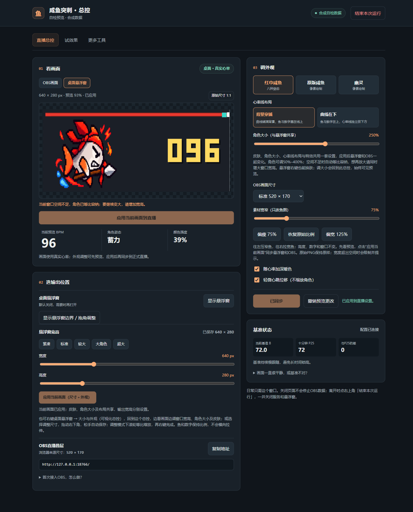

# 最新更新：悬浮窗右键隐藏

仅重开桌面窗口，后台与OBS来源保持；详见 [HUD_MENU_FIX.md](HUD_MENU_FIX.md)。

# 最新更新：可视化蓝牙设备选择

已正常备份安装，46项后端与32组浏览器流程通过；真机扫描成功，所选手表未广播，真实心率接入未核验。完整说明见 [BLUETOOTH_VERIFICATION.md](BLUETOOTH_VERIFICATION.md)。

# 现用目录安装与重启记录

**状态：已在用户明确授权后安装并重启。**

## 最新更新：低饱和像素与古典风前端

已安装8个产品文件并正常重启，个人配置与42个配置/历史文件哈希保持。完整备份`G:\downloads\heart-rate-backups\before-classical-design-20261016-222350`。本轮验证与截图见 [DESIGN_VERIFICATION.md](DESIGN_VERIFICATION.md)，当前页首次按F5载入新样式。

## 上一轮更新：前端标签、遮挡与按钮恢复

- 现用目录安装6个产品文件，原一键开播VBS已正常启动，核验后台服务、受管悬浮窗各一个。页面需要首次刷新载入本次新脚本；不会要求此后每次重启都先刷新才能恢复按钮。
- 完整备份`G:\downloads\heart-rate-backups\before-control-audit-20261016-214651`，正常停止后刷新备份；41个个人配置与历史文件在更新前后哈希相同。用户150%素材默认、当前缩放及381×95窗口保持，未向现用服务写测试参数或模拟心率。
- 三标签对应操作区立即可见；更多工具默认加载历史，控件全部放在预览旁避免被固定预览盖住。边界连点、过期凭证、断线后的草稿与按钮恢复、失败提示、结束后新会话恢复均已修复。预览尺寸变化不再用旧布局暂画到新画布。
- 29项后端回归、12组原浏览器回归、12组实际按钮交互及108组鱼图对照通过。按钮检查含真实可见Chrome点击、点击点遮挡检查、390px窄屏、503错误与重连；复制与校准使用替身，未更改系统剪贴板或实际基准。
- 安装后只读HTTP确认新导航、反馈、会话逻辑及受管HUD已就绪。手表在最后核验时已连接且有新读数。本轮未自动点击现用窗口或进行OBS录制验收。

证据：[本次安装](evidence/control-audit-install.json)、[实际按钮检查](evidence/control-actions-results.json)、[现用HTTP](evidence/installed-control-audit-http.json)、[进程](evidence/installed-control-audit-processes.json)。

## 上一轮更新：用户选定默认150%

已从后端读取用户当前素材宽度150%，将后端默认值、网页兜底及滑块初值统一为150%，新增默认150%按钮，仍保留原始100%。正常重启后核验/params及/params/schema均为1.5，当前135%缩放和381×95窗口保持。40个私人配置/日志更新前后哈希一致；完整备份：G:\downloads\heart-rate-backups\before-preferred-width-20261016-165111。4项定向布局/图像检查和硬约束核查通过。当前页面首次刷新即可看到默认150%按钮。

## 上一轮更新：素材宽窄滑块

- 用户澄清要调整素材中鱼的横向比例。现用目录新增**调外观 → 素材宽窄（只改鱼图）**，50%–150%；提供偏瘦75%、偏宽125%及恢复原始比例100%。显示时只改横向，保持高度、数字和画布不变；宽度超出空间时受限。
- 点击“应用当前画面”后保存到共享fishWidth，HUD与OBS跟随。此项只针对红巾咸鱼八PNG；不改原始素材文件。默认100%，未擅自替用户选定75%。
- 已安装7个产品文件并通过原一键开播VBS正常重启。备份`G:\downloads\heart-rate-backups\before-fish-width-20261016-164402`，39个私人配置与历史文件更新前后哈希相同；没有向现用服务提交测试参数。
- 28项回归、12组浏览器检查及108组原生/浏览器鱼图布局、RGBA像素哈希对照通过，含75%/100%/125%、预览隔离、应用保存、OBS同步及复原。核验现用HTTP已返回新滑块和默认100%设置；手表在当次核验已连接。
- 已打开的总控需刷新一次载入新滑块；OBS来源首次刷新以支持新增参数。本轮未对现用窗口自动点击或操作OBS场景。

证据：[本次安装](evidence/fish-width-install.json)、[108组对照](evidence/visual-parity-results.json)。

## 上一轮更新：预览与原生尺寸一致、统一可视化调整

- 现用目录已更新9个产品文件，原`一键开播（总控+悬浮窗）.vbs`已实际调用，正常重启服务及其受管悬浮窗；只读进程核验各一个。
- 完整备份：`G:\downloads\heart-rate-backups\before-visual-parity-20261016-162631`。停机后刷新备份，37个个人配置与历史文件在更新前后哈希一致。保留用户当前240×104、红巾咸鱼和130%角色设置；未提交测试参数或心率。
- 布局与PNG缩放统一到hr_visual.py，网页和原生共用；总控显示画布宽高/预览百分比/草稿状态，能切换原始尺寸、显示实际HUD边界并拖角。“应用当前画面”一起保存外观与尺寸；原生调整入口回到同一个可视化总控。
- 27项回归、12组浏览器检查通过；36组真实Tk图像与可见Chrome Canvas的布局和鱼图RGBA哈希全部一致，另有原生拖角、SSE、保存失败重试和退出检查。对照关闭暖色/心跳并固定姿态，不代表整幅画面/相位逐帧一致。
- 安装后只读HTTP核验新控件源码、统一布局、精确缩放PNG字节与八原图哈希通过。手表连接及新心率在当次核验均正常；没有改变蓝牙算法或连接设置。
- Computer Use因无法可靠确定浏览器URL而停止；未通过其他UI自动化操作现用窗口。实际总控点击、窗口数量与OBS录制本轮未验收。**已打开的总控及OBS来源各刷新一次**以载入新代码；此后仍使用原一键入口。

证据：[本轮安装](evidence/visual-parity-install.json)、[现用HTTP检查](evidence/installed-visual-http.json)、[现用进程检查](evidence/installed-visual-processes.json)、[36组对照](evidence/visual-parity-results.json)。

## 上一轮更新：大尺寸与共享外观

- 现用`G:\downloads\heart-rate`已更新，用户指定的`一键开播（总控+悬浮窗）.vbs`已实际启动；确认服务、受管悬浮窗和总控窗口各一个。总控按精确标题及Chrome/Edge程序身份枚举并刷新，避免复用旧网页脚本。
- 右键悬浮窗 → **大小与外观（滑块）**：直接调角色50%–400%、窗口宽160–1920、高64–1080。右键**皮肤（同步OBS）**立即换肤，写入共享参数；总控与OBS跟随。输出画布宽高分别保留。
- 新增640×280和960×420桌面预设；OBS增加800×320和1200×450预设。大角色等比容纳，给数字和冲刺留位；不改心率算法或原PNG。
- 完整备份：`G:\downloads\heart-rate-backups\before-shared-appearance-20261016-160147`。停机后刷新备份，36个个人配置与历史日志在更新前后哈希一致。当前皮肤和倍率未被测试覆盖，安装检查只读，没有提交现用测试配置。
- 23项自动回归、12组可见Chrome及原生滑块/共享SSE/保存失败重试、绘制与生命周期检查通过。现用页面确认新400%和1920×1080范围、预设、八PNG哈希和双布局，零页面异常。设备在本次核验时已连接。
- OBS已有来源首次刷新以载入新绘制代码；若URL固定`skin`或`fishScale`仍优先，应使用总控复制的根地址以跟随共享设置。本次未修改OBS场景或进行录制验收。

证据：[本次安装](evidence/shared-appearance-install.json)、[现用页面](evidence/installed-results.json)、[进程数量](evidence/installed-processes.json)、[自检说明](VERIFICATION.md)。

## 上一轮更新：悬浮窗交互尺寸

已更新现用`G:\downloads\heart-rate`，重开一个总控与一个受管悬浮窗。入口仍为`一键开播（总控+悬浮窗）.vbs`。

- 默认紧凑**240×104**，宽高现在独立于OBS；总控“选输出位置 → 悬浮窗宽高”提供1px滑块、三档预设与桌面预览，专用按钮只保存桌面尺寸。
- 右键悬浮窗进入尺寸调整模式，拖右下角松手自动保存；调整模式下滚轮等比缩放；再右键完成返回透明画面。双击切换紧凑/标准/较大，主体左键仍移动窗口。
- 宽高写入统一params.json并广播，位置/置顶仍在hud.json。鱼与数字按整像素单位排布，不横向拉伸。保存失败可见并能重试；调整不重启或另开进程。
- 完整备份：`G:\downloads\heart-rate-backups\before-interactive-hud-20261016-154100`。正常退出后刷新备份，35个私人配置与历史日志在代码更新前后哈希一致，没有覆盖用户参数、设备或日志。
- 现场只读浏览器检查桌面尺寸为240×104、OBS尺寸仍为520×170；编辑宽度只改变预览，撤销恢复，没有向现用服务提交测试参数。八张PNG哈希、双布局、页面异常与进程数量检查通过。
- 当次设备未连接；日志显示连接超时及未发现广播，后台继续自动重试。尺寸设置可独立使用。 没有操作OBS场景或录制。

证据：[本次安装](evidence/interactive-hud-install.json)、[现用页面](evidence/installed-results.json)、[进程计数](evidence/installed-processes.json)、[原生交互检查](evidence/hud-resize.txt)。23项自动回归、11组浏览器检查与原生子进程检查见VERIFICATION.md。

## 上一轮更新：用户新八帧素材

已把`fish_states_8png.zip`的八张独立PNG原样安装到现用`G:\downloads\heart-rate`，重开总控与受管悬浮窗。当前皮肤、心率参数与心率线布局保持用户原设置；入口仍为`一键开播（总控+悬浮窗）.vbs`。

- 八帧均使用576×384透明画布与(288,224)锚点，取消旧图逐帧偏移。已核验实际HTTP返回的八张PNG哈希与输入一致。
- 总控采用冷静、好奇、专注、紧张、慌张、蓄力、突刺、收招名称；网页与原生HUD不再叠加与新图重复的程序水花/速度条，原版像素鱼特效保留。
- 完整备份：`G:\downloads\heart-rate-backups\before-new-sprites-20261016-150813`。正常退出服务后刷新私人文件备份，34个配置与历史日志在更新前后哈希一致。
- 实际8080目录标识与协议正确；新八帧加载、双布局预览切换与撤销正常，无页面异常；一个服务、一个HUD、一个总控窗口；当次观察到真实设备连接。
- OBS已有浏览器来源请刷新一次。没有操作OBS程序、场景或录制，也未向现用服务写入模拟心率和测试参数。

证据：[新素材安装记录](evidence/sprites-install.json)、[素材核验](evidence/new-sprites-inspection.json)、[现用页面](evidence/installed-results.json)、[进程计数](evidence/installed-processes.json)。完整测试记录见VERIFICATION.md。

## 上一轮更新：两种心率线布局

已在现用目录安装双布局并正常退出、重启服务与受管HUD，重新打开总控以加载新按钮。入口仍为`一键开播（总控+悬浮窗）.vbs`。

- 默认恢复**背景穿插**：曲线铺满背景，角色与数字覆盖在线条上方。
- 保留**曲线在下**：角色与数字在上带，曲线独立在下方。
- 总控“调外观 → 心率线布局”选择后先预览，应用才保存并同步OBS/HUD；选择在刷新和重启后保留。
- 完整备份：`G:\downloads\heart-rate-backups\before-layout-choice-20261016-140347`。正常退出旧服务后刷新备份并校验33个私人文件，代码更新没有改变它们；没有向真实服务注入模拟心率或写入测试参数。
- 更新后8080协议与现用目录标识正确，实际页面两选项可见、预览切换与撤销正常；一个服务、一个受管HUD、一个总控窗口；当次检查真实心率设备已连接。
- 现有OBS浏览器来源需刷新一次以加载新版绘制代码，后续选择通过广播同步。没有操作OBS或验收录制。

证据：[安装记录](evidence/layout-install.json)、[现用页面与接口](evidence/installed-results.json)、[进程计数](evidence/installed-processes.json)。

以下为此前安装的历史记录。

- 安装目录：`G:\downloads\heart-rate`
- 完整备份：`G:\downloads\heart-rate-backups\before-total-control-20261016-132848`
- 仅在核验脚本与创建时间后关闭旧服务3732、旧控制台8128；新版只有一个心率服务进程。
- 安装前后校验32个私人配置/历史日志文件，SHA256全部一致；启动后再次核对仍为32/32一致。私人文件及其哈希索引只留在本地与备份中，没有进入发行包。
- 常用入口及旧嵌套BAT已指向同一VBS；保留旧嵌套代码与数据以便回退。
- 实际双击链路启动了总控Chrome应用窗口；再次运行入口复用原服务与窗口，无额外Tk控制台，无自动HUD。
- 8080返回`app=fish-heart-hit`、`control_protocol=2`，`root_id`与现用目录一致；`/console`正常，素材清单200，`/effects`跳转总控。
- 可见Chrome只读检查没有页面异常，没有向现用服务提交模拟心率或改写参数；当次检查已观察到真实设备连接。
- 初次启动HUD关闭；后续验收时总控已报告HUD开启，保留了当时状态，没有为测试强制关闭。

安装验收证据：[页面与接口](evidence/installed-results.json)、[运行进程计数](evidence/installed-processes.json)。源码逐文件哈希记录见MANIFEST.sha256；实际目录另有用户私人数据、运行日志和保留的历史文件，不属于公开发行文件清单。

## 使用

以后双击现用目录里的`一键打开咸鱼总控.vbs`。日常只需总控窗口，悬浮窗按需打开；退出时点右上角“结束本次运行”。关闭网页本身会保留服务供OBS使用。

需要同时出现总控和悬浮窗时，双击`一键开播（总控+悬浮窗）.vbs`。该入口已安装到现用目录并实跑两次，均复用同一服务、总控窗口和受管HUD。没有重启现用服务或改写私人参数。入口变更前另存于`G:\downloads\heart-rate-backups\before-oneclick-hud-20261016-134502`；[实际检查记录](evidence/oneclick-hud-installed.json)。

安装时保留了原先的ghost皮肤设置。需要红巾咸鱼时，在总控选“红巾咸鱼”，点击“应用到直播”。OBS旧地址如带固定skin/参数，要按页面说明去掉覆盖项并刷新一次来源。

## 回退

先在新版总控结束本次运行。将现用目录保留为故障现场，再从上方完整备份恢复到原路径；不要把含私人数据的备份作为公开安装包发送。恢复旧BAT后可按旧方式启动。没有删除旧数据。

## 验证边界

20项自动测试、8组可见浏览器检查和实际Tk生命周期检查详见VERIFICATION.md。安装后“设备已连接”只是当次运行观察，不代表已完成长时间连接/重连测试；未操作OBS场景，也未验收OBS CEF或最终录制。
