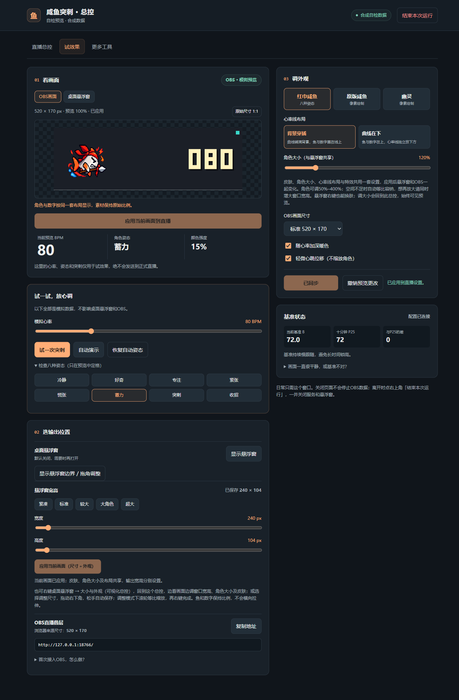
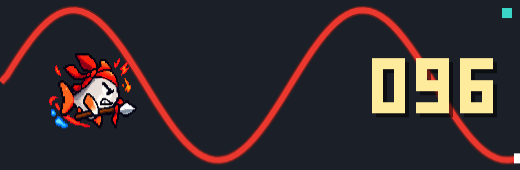
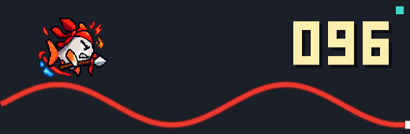
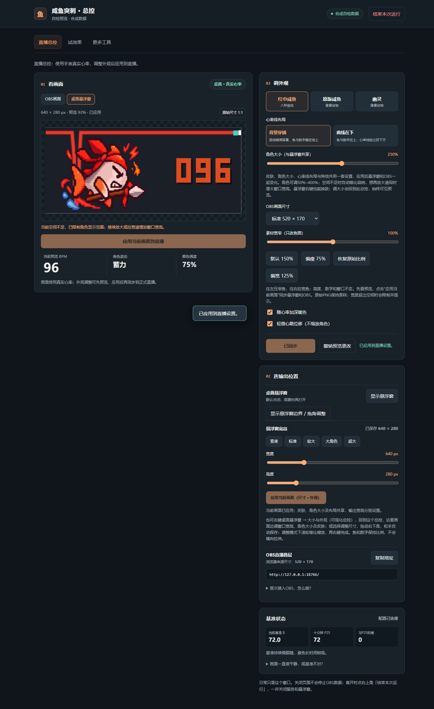

# 最新蓝牙功能验证

见 [BLUETOOTH_VERIFICATION.md](BLUETOOTH_VERIFICATION.md)：本轮46后端、32浏览器流程，真实广播扫描与真实心率接入的边界分别记录。下方为此前版本记录。

# 最新视觉改造验证

本轮实际运行：29后端、12原浏览器、12按钮、4视觉专项；详见 [DESIGN_VERIFICATION.md](DESIGN_VERIFICATION.md)。以下保留历史验证记录，108组鱼图对照为此前结果。

# 本轮自检记录

当前版本已接入用户的八张新状态PNG，保留两种心率线布局与一键总控，并增加桌面悬浮窗的独立宽高与交互缩放。自动验证使用合成数据，没有向现用服务注入模拟心率或写测试参数。

| 检查 | 结果与证据 |
|---|---|
| 自动回归 | **29项通过**，含新PNG哈希、RGBA文件头、统一尺寸/锚点以及已有后端、参数、启动与退出检查；[原始输出](evidence/unittest.txt) |
| 可见Chrome | **12组通过**，包括八帧加载、归一化像素不变、固定几何、关闭重复水花、原版鱼特效保留、双布局同步、草稿隔离、保存重载、URL覆盖及390px窄屏；[浏览器记录](evidence/browser-results.json) |
| 原生Tk | 三皮肤、四倍率、五角色大小、八帧与两布局检查通过；新图不再叠水花，原版鱼仍显示特效；幽灵量化及同窗口切换保留；[记录](evidence/desktop-results.txt) |
| 输入素材 | 八张均为576×384 RGBA，Alpha通道存在、四边透明，PNG逐字节与用户ZIP一致；[核验报告](evidence/new-sprites-inspection.json) |
| 硬约束 | 冻结updateAlgo文本一致，幽灵五个像素方法AST一致，依赖不变，7BAT均GBK/936/CRLF，VBS为UTF-16；[记录](evidence/invariants.json) |

白色鱼身亮色主连通域的阈值估计为宽207~208、高160，中心横坐标287.5~288.5、纵坐标224；这个估计不是严格解剖边界测量。使用用户给定的共同(288,224)锚点，不逐张根据枪、尾巴或水花的外接框缩放。不同姿态的局部像素仍可能变化，不声称原画已达到连续逐帧动画清理标准。

下面截图均来自可见Chrome、合成数据，不是OBS录制。已人工查看八张原图，以及冷静、收招、突刺与两种布局的实际截图。

[冷静](evidence/state-idle.png) · [好奇](evidence/state-alert_low.png) · [专注](evidence/state-alert_mid.png) · [紧张](evidence/state-tense.png) · [慌张](evidence/state-high.png) · [蓄力](evidence/state-charge.png) · [突刺](evidence/state-burst.png) · [收招](evidence/state-recover.png)

先前的一键入口/原生HUD生命周期专项记录仍保留：[Windows入口](evidence/windows-entry.txt)、[实际Tk子进程](evidence/native-lifecycle.txt)。本轮没有改启动器或HUD进程生命周期。

## 现场安装与验证边界

安装目录、完整备份、私人文件保留及8080检查见[INSTALL_REPORT.md](INSTALL_REPORT.md)。现用页面GET核查与进程数量另有证据；真实画面截图只保留在本机工作目录。

尚未完成真实手环长时间连接/重连、原始CSV触发频率评估、OBS CEF和最终录制验收。常态档位和配置已由服务器共享；突刺历史、冷却与心跳相位仍由各渲染器维护，不承诺跨窗口同一帧触发。素材替换没有改变这些心率判据。

## 最新验证：统一布局与可视化调整

- 27项自动回归通过，含布局/PNG只读API与非法参数、共享控制入口和原生边界命令；12组可见Chrome回归通过，当前预览草稿由同一个按钮一并保存尺寸和外观。
- 36组对照：三画布（240×104、211×119、640×280）、两倍率（130%、400%）、两布局、三姿态（冷静/突刺/收招）。原生真实Tk PhotoImage导出，与可见Chrome实际Canvas图像取RGBA字节；**所有布局完全一致，鱼图RGBA SHA256全部相同**。测试固定姿态，关闭暖色与心跳位移；不声称整个画面/动画相位逐帧一致。[原生记录](evidence/native-visual-parity.json)、[对照结果](evidence/visual-parity-results.json)。
- 对照另验画布宽高/缩略百分比/1:1切换、总控操作实际HUD边界、高级工具仍显示主预览。原生鼠标拖角松手保存、远程尺寸/皮肤、失败重试和托管退出继续通过。
- 原图八PNG与输入ZIP字节相同，依赖不变；冻结心率算法与五个幽灵方法保留。无新增Pillow依赖，PNG缩放只使用Python标准库。
- 现用窗口的Computer Use检查因工具无法可靠确认浏览器URL而停止，未通过其他UI自动化绕过；全部绘制/交互自动验证在隔离测试窗口完成。安装后的HTTP与进程核验单独记录，不冒充现用窗口点击或OBS录制验收。

## 最新补充：素材宽窄

28项自动回归和12组浏览器回归通过。108组Tk实际图像与可见Chrome Canvas的布局/鱼图RGBA哈希全部一致，增加75%/100%/125%横向比例。另验宽窄滑块先只影响预览，应用后保存并同步OBS页面，恢复按钮回到100%；高度和数字位置不变。原始八张PNG仍逐字节与输入ZIP一致。[对照结果](evidence/visual-parity-results.json)。

## 最新前端按钮审查

- 29项后端回归通过，新增无手表读数时的真实SSE心跳；原12组可见Chrome回归与108组鱼图对照通过。
- 新增check_control_actions.cjs，使用可见Chrome的实际点击与点击点遮挡检查，覆盖桌面/390px标签、模拟控件、三工具、键盘导航、令牌过期、连点、断线重连、503保存重试、无传感器时服务可用、结束/新会话恢复。校准拒绝与复制成功/失败采用API替身，明确验证UI反馈，不改真实基准或系统剪贴板。
- 测试完全使用18766隔离服务，没有向现用8080提交测试参数、模拟心率、校准或退出请求。现场部署的正常停止与重启另有授权记录。[按钮检查](evidence/control-actions-results.json)。
- 已查看实际测试截图：[试效果](evidence/control-demo-accessible.png)、[更多工具](evidence/control-tools-accessible.png)、[窄屏](evidence/control-mobile-tabs.png)。
